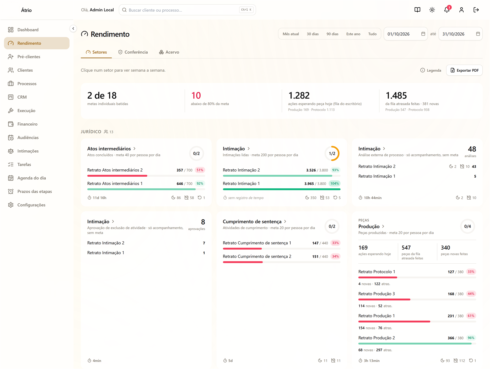
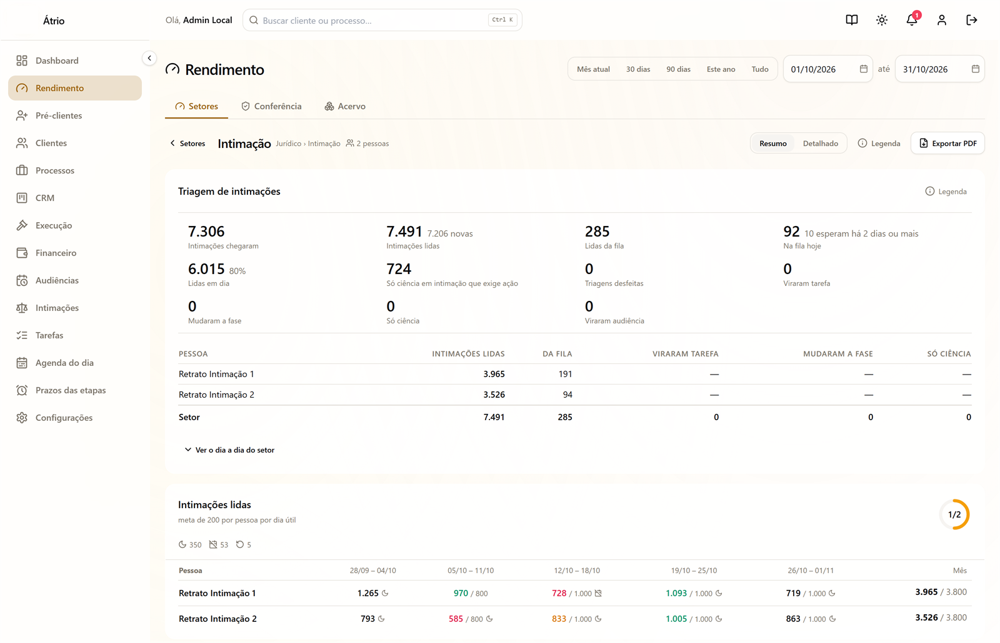
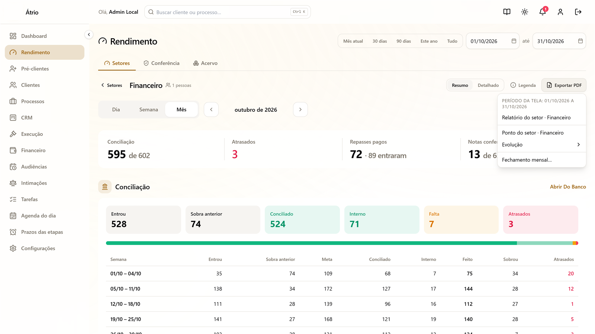
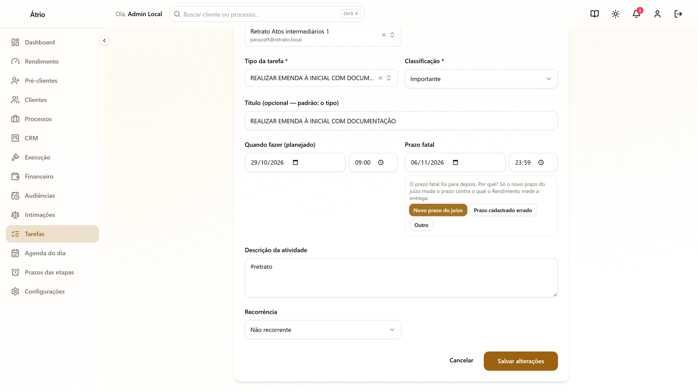
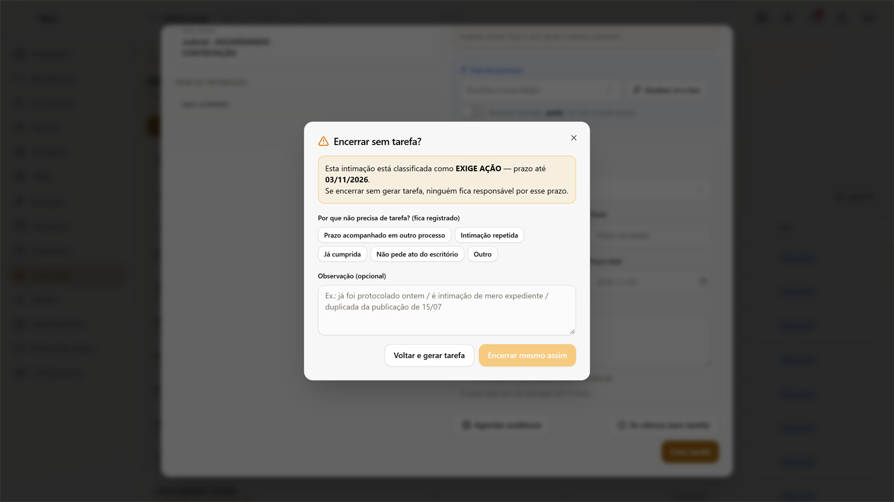
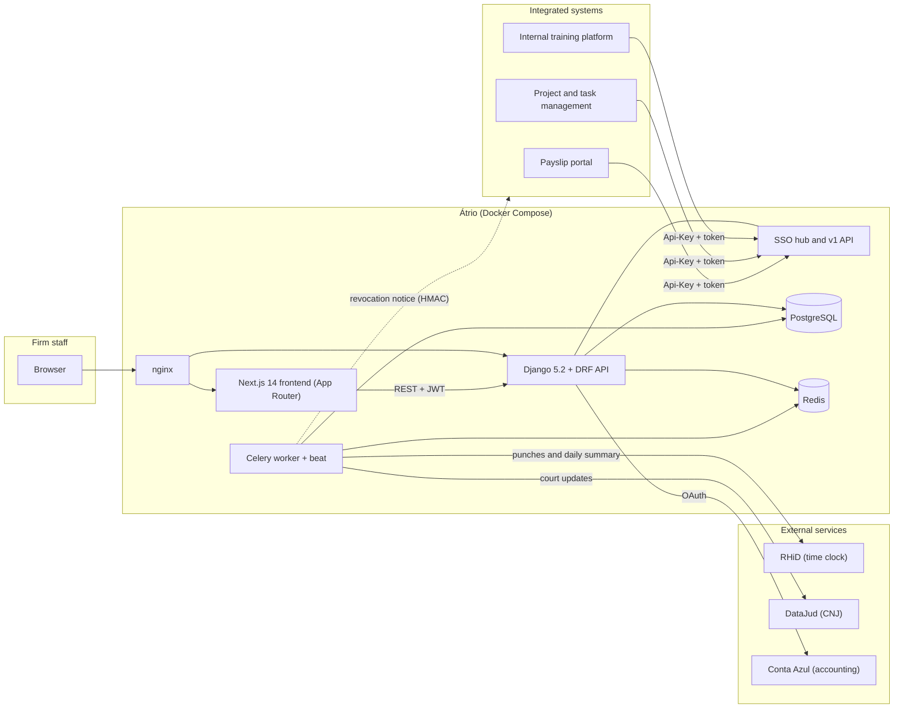
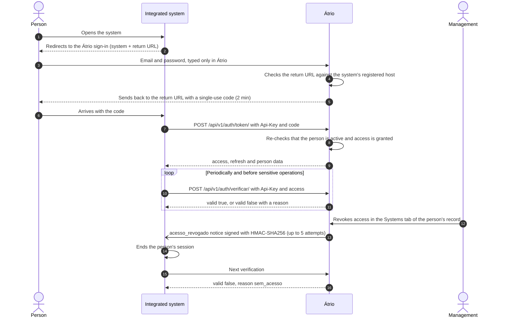
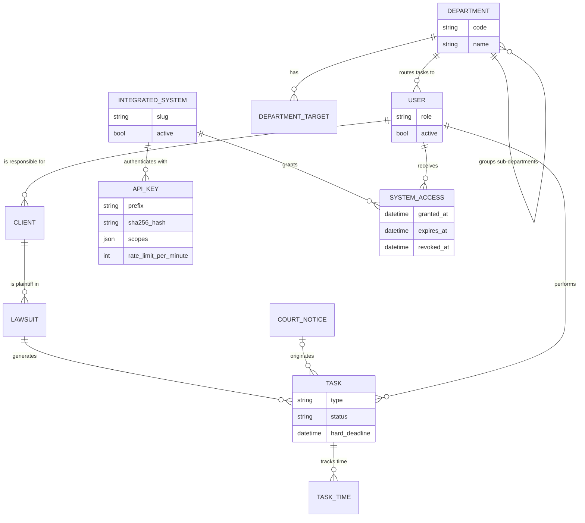

# Átrio — central registry and single sign-on for a law firm

🇧🇷 [Versão em português](README.md)

## Context

A law firm in Manaus, Brazil, focused on consumer banking litigation, was running on a legacy system,
one spreadsheet per department and a separate user base and password in every internal tool. Átrio is
the firm's core system: it brings clients, lawsuits, tasks, court notices, departments and finance into
one place, and it is also the front door to the firm's other systems. Anyone who signs in to an
integrated system signs in through Átrio, and anyone deactivated or cut off in Átrio loses access to all
of them.

## Highlights

- **Central registry**: clients and leads (CRM), lawsuits on a kanban board per case group, tasks with
  timer, comments and attachments, departments and sub-departments at any depth, and a court catalog
  (court, district, chamber) to pick from instead of typing.
- **Court notices**: triage with workflows that create the right tasks for the right department.
  Closing a notice that requires action without creating a task asks for a reason, which is logged.
- **Single sign-on hub**: integrated systems authenticate through Átrio (authorization code exchanged
  with an API key), periodically ask whether the person may still get in, and receive a signed
  notification when access is revoked.
- **v1 API for integrations**: one key per system (stored only as a hash), per-module scopes
  (read/write), per-key rate limiting, and a people list so a system can set up accounts before the
  first sign-in.
- **Finance and enforcement phase**: bank statement import, reconciliation, credit card invoices, P&L
  and cash flow; judgment compliance, payments, settlements and invoice review, replacing spreadsheets.
- **Performance (Rendimento)**: targets per department and per person, firm-wide and per-department
  deadlines, the queue of pending filings, notice triage, field work and hearing schedules, with PDF
  reports.
- **Time clock**: punches and daily summaries from the time clock service (RHiD) flow in automatically,
  and management can compare attendance with system usage.
- **Operations**: court updates via DataJud (Brazil's national judicial data API), automations the team
  writes and switches on itself, in-app notifications, an audit trail, other people's changes showing up
  on screen within seconds, and about 4,600 automated backend tests (pytest).

## Screens

> Screenshots from an anonymized snapshot of the system: people appear as "Retrato &lt;department&gt; N".
> Screens showing client names, case numbers or money amounts were left out. The interface is in
> Portuguese.

| | |
|---|---|
|  |  |
| **Performance overview** — each department with per-person targets and progress in the period. | **Notice triage** — what arrived, what was read on time and what became a task. |
|  |  |
| **PDF reports** — department, time clock, trend and monthly close. | **Hard deadline with a reason** — postponing asks why; only a new court deadline moves the baseline. |
|  | |
| **Triage guardrail** — a notice that requires action can't be closed without a task unless a reason is given. | |

## Architecture

The backend runs on gunicorn; the same codebase powers the Celery worker and scheduler (beat, with the
schedule kept in Redis), which handle time clock sync, court updates, nightly automations and delivery of
revocation notices. In production everything runs on a self-hosted server with Docker Compose behind
nginx, with a PostgreSQL instance shared by the firm's applications.

## Single sign-on and access revocation

Átrio answers a single question: *who does this token belong to, are they still active, and may they
enter **this** system?* What they can do inside each system remains that system's business.

## Core data model

Simplified model, main entities only.

## Stack

| Layer | Technologies |
|---|---|
| Backend | Python 3.13, Django 5.2, Django REST Framework, SimpleJWT, drf-spectacular (OpenAPI), django-filter |
| Async jobs | Celery (worker + beat with RedBeat), Redis |
| Database | PostgreSQL |
| Frontend | Next.js 14 (App Router), React 18, TypeScript, Tailwind CSS, shadcn/ui, Motion, TanStack Query and TanStack Table, React Hook Form + Zod |
| Reports | ReportLab (PDF), ExcelJS (in-browser spreadsheets) |
| Integrations | RHiD API (time clock), DataJud (CNJ), Conta Azul (OAuth), HMAC-signed webhooks |
| Tests | pytest (backend), Vitest (frontend) |
| Infrastructure | Docker Compose, gunicorn, nginx, Sentry, self-hosted server |
| Tooling | uv (Python), pnpm (Node) |

## Technical decisions and challenges

- **Identity, not authorization.** The hub says who the person is, whether they are active and whether
  they are allowed into that system, and nothing about their role inside it. If roles travelled along, a
  promotion in Átrio would silently change permissions in systems nobody would remember to review.
- **Passwords never reach the integrated system.** With the code flow, people type their password only
  in Átrio and come back with a single-use code valid for two minutes. The code can only be exchanged for
  tokens with the system's API key, and the return URL must be on the registered host: an intercepted
  code is useless and there is no open redirect.
- **The notice is a nudge; verification is the source of truth.** Revoking access fires a signed webhook
  (HMAC-SHA256, retried with growing back-off), but systems keep asking `/verificar/`. If the notice is
  lost, the door closes on the next check. The signature exists because the API key is stored only as a
  hash, so Átrio cannot reproduce it.
- **Rotating tokens with a blacklist.** Every refresh returns a new refresh token and invalidates the
  previous one, and sessions end after inactivity. A leaked refresh token can actually be cut off.
- **Time clock without manual rework, and careful with personal data.** RHiD is the source; Átrio only
  copies. Punches are polled more often around arrival and departure times, with a lock so a slow read
  doesn't overlap the next one. Employees are linked to users by name (the two systems share no other
  field), and individual clock-in times are visible to management only.
- **Measure against the right deadline.** In Rendimento, delivery is measured against the original hard
  deadline; postponing requires a reason, and only a new court deadline moves the baseline. Targets
  don't improve just because someone pushed a date.

## My role

Átrio is built by a small team, and I am not the main author: on `main` I have 135 of the 1,353 commits,
between October and November 2026. The registry, lawsuits, court notices, finance and the SSO hub were
built by other team members. What I did:

- **Created the Rendimento (performance) module**, backend and frontend, replacing the old metrics
  screen:
  - targets per department and per person (fixed, monthly, against incoming work, as a percentage of
    incoming work, or tracking only), and the firm's working hours, which separate work done during
    hours, after hours and on days off;
  - activity metrics configured in Settings, and average time from the task timer (or from dates when
    there is no timer);
  - per-department dashboards by day, week and month: queue of pending filings by case month, notice
    triage, field work and hearings from the daily schedule, and the Finance department (reconciliation,
    payments and invoices, each number opening its matching list);
  - firm-wide and per-department deadlines: missed tasks, on-time delivery, age of open items, original
    hard deadline and unassigned tasks;
  - PDF reports with ReportLab (department, person, time clock, trend and monthly close).
- **Integrated the RHiD time clock**: API client, periodic sync via Celery beat, daily close, the
  `sincronizar_rhid` command (with a check mode that writes nothing), the screen linking employees to
  users, and an attendance × system-usage index visible only to management.
- **Departments and sub-departments at any depth**, with sub-departments rolling up into the parent.
- **Tasks are created from their type**, and every line of the court-notice workflows has its own
  activity type.
- Targeted fixes in Finance (matching credits to their payment line, the "not located" status, and
  dismissing the possible-duplicate-purchase alert on card invoices).

---

Átrio's source code is private; this repository is a showcase only, with no source code. Contact:
[github.com/roger-mont](https://github.com/roger-mont).
