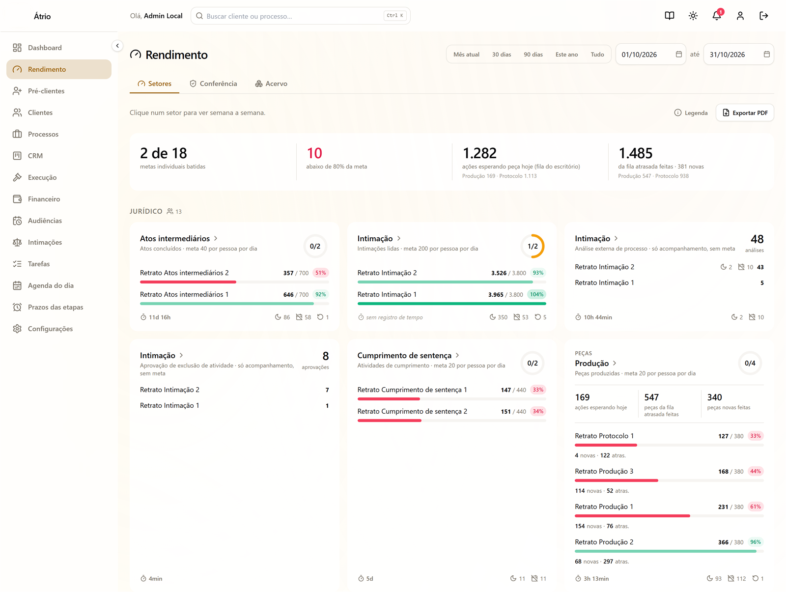
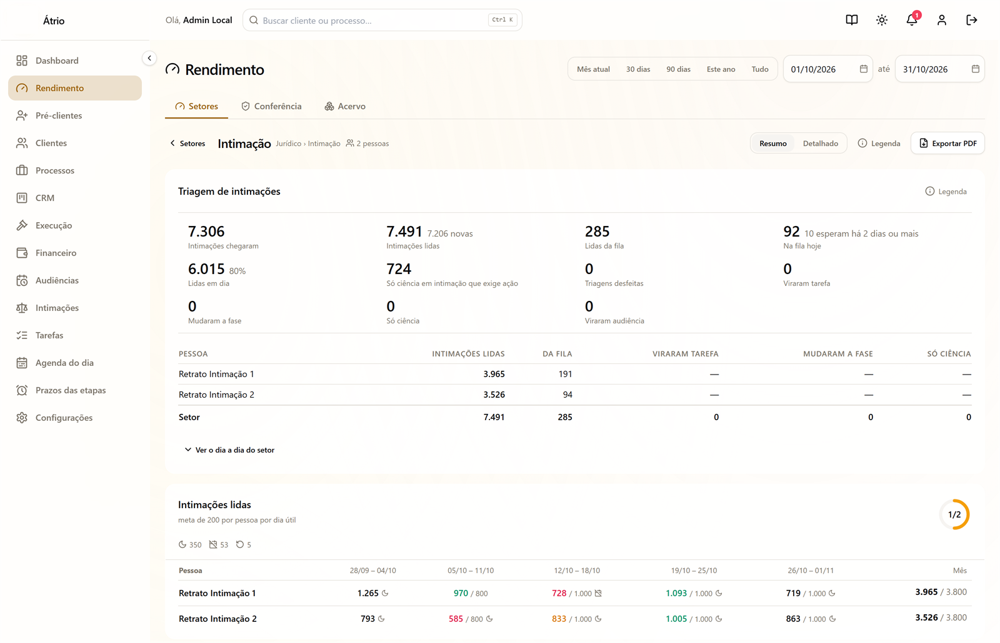
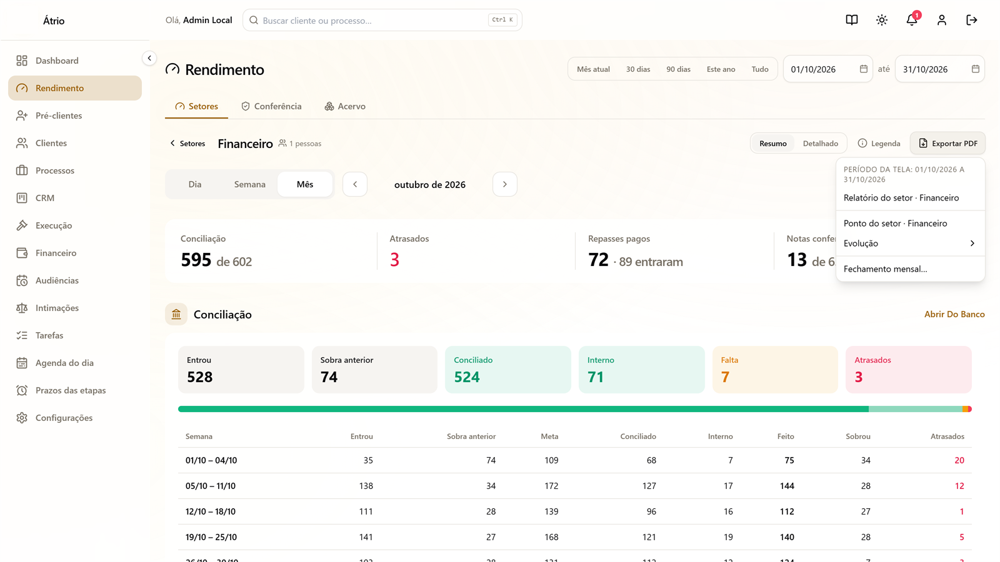
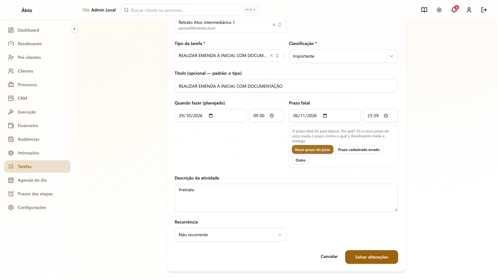
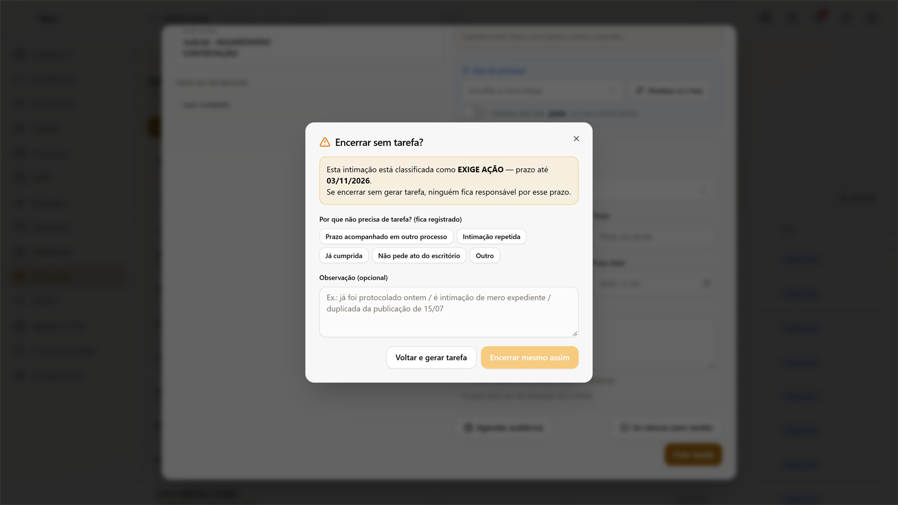
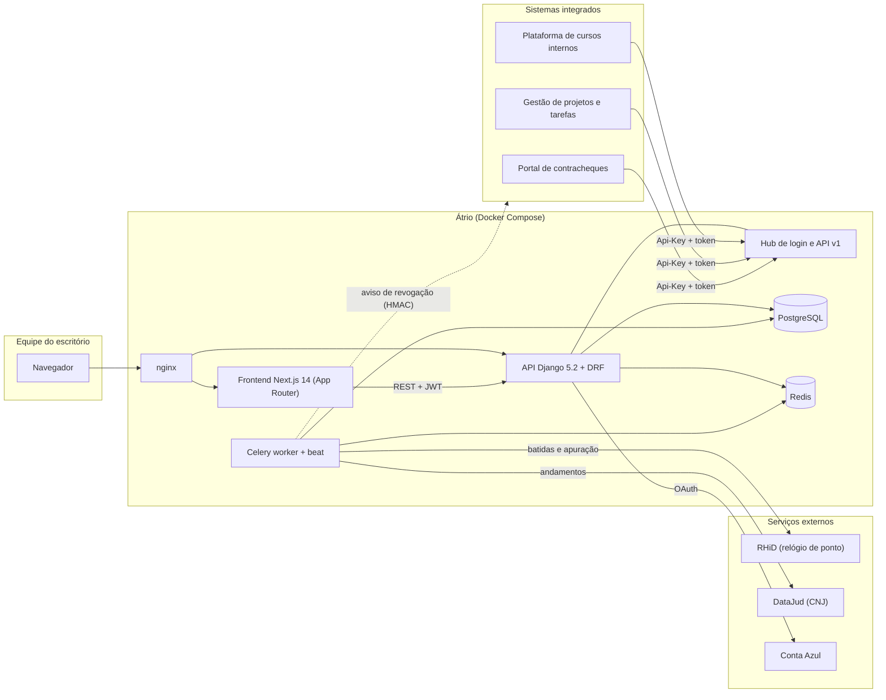
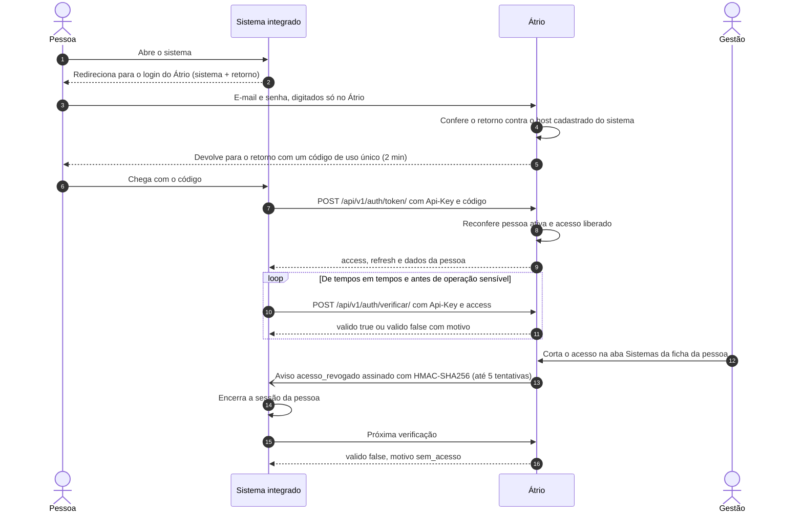
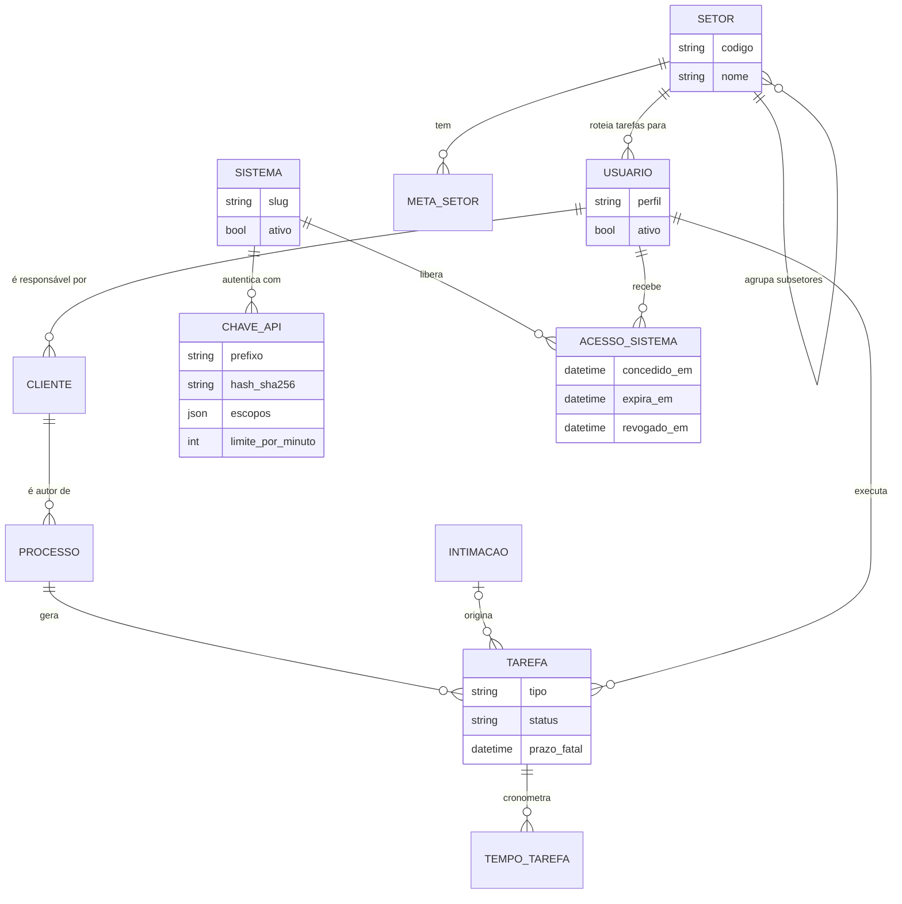

# Átrio — cadastro central e login único de um escritório de advocacia

🇺🇸 [English version](README.en.md)

## Contexto

Um escritório de advocacia em Manaus, focado em direito do consumidor bancário, trabalhava com uma base
legada, planilhas por setor e um cadastro de pessoas e senha separado em cada sistema interno. O Átrio
é o sistema central do escritório: concentra clientes, processos, tarefas, intimações, setores e
financeiro num lugar só e, além disso, é a porta de entrada dos outros sistemas da casa. Quem entra num
sistema integrado entra pelo Átrio, e quem é desligado ou tem o acesso cortado no Átrio deixa de entrar
em todos eles.

## Destaques

- **Cadastro central**: clientes e pré-clientes (CRM), processos em quadro kanban por grupo de ação,
  tarefas com cronômetro, comentários e anexos, setores e subsetores em vários níveis, catálogo do
  Judiciário (tribunal, comarca, vara) para escolher em vez de digitar.
- **Intimações**: triagem com workflows que geram as tarefas certas para o setor certo. Encerrar uma
  intimação que exige ação sem gerar tarefa pede um motivo, que fica registrado.
- **Hub de login único**: os sistemas integrados autenticam pelo Átrio (fluxo por código com troca por
  chave de API), perguntam periodicamente se a pessoa ainda pode entrar e recebem aviso assinado quando
  o acesso é cortado.
- **API v1 para integrações**: uma chave por sistema (guardada só como hash), escopos por módulo
  (leitura/escrita), limite de chamadas por chave e lista das pessoas para o sistema preparar as contas
  antes do primeiro login.
- **Financeiro e fase de execução**: importação de extrato bancário, conciliação, faturas de cartão, DRE
  e fluxo de caixa; cumprimentos, pagamentos, acordos e conferência de notas fiscais, no lugar das
  planilhas.
- **Rendimento**: metas por setor e por pessoa, prazo do escritório e de cada setor, fila de peças,
  triagem, agenda de diligências e audiências, com relatórios em PDF.
- **Ponto eletrônico**: as batidas e a apuração do relógio de ponto (RHiD) entram sozinhas, e a gestão
  cruza o ponto com o uso do sistema.
- **Operação**: andamentos do tribunal via DataJud, automações que a própria equipe escreve e liga,
  notificações no sino, trilha de auditoria, mudanças de outras pessoas aparecendo na tela em poucos
  segundos e cerca de 4.600 testes automatizados no backend (pytest).

## Telas

> Prints de um retrato anonimizado do sistema: as pessoas aparecem como "Retrato &lt;setor&gt; N".
> Telas com nomes de clientes, números de processo ou valores em dinheiro ficaram de fora.

| | |
|---|---|
|  |  |
| **Panorama do Rendimento** — cada setor com a meta por pessoa e o andamento no período. | **Triagem de intimações** — o que chegou, o que foi lido em dia e o que virou tarefa. |
|  |  |
| **Relatórios em PDF** — do setor, do ponto, evolução e fechamento mensal. | **Prazo fatal com motivo** — adiar o prazo pede o porquê; só um novo prazo do juízo muda a régua. |
|  | |
| **Trava na triagem** — intimação que exige ação não se encerra sem tarefa sem um motivo. | |

## Arquitetura

O backend roda com gunicorn; o mesmo código serve o worker e o agendador do Celery (beat com
agendamento no Redis), que cuidam da sincronização do ponto, dos andamentos, das automações noturnas e
do envio dos avisos de revogação. Em produção tudo roda em servidor próprio com Docker Compose, atrás de
nginx, com o PostgreSQL compartilhado entre as aplicações da casa.

## Login único e revogação de acesso

O Átrio responde uma pergunta só: *quem é a pessoa deste token, ela ainda está ativa e pode entrar
**neste** sistema?* O que ela pode fazer lá dentro continua sendo regra de cada sistema.

## Núcleo do cadastro

Modelo simplificado, só com as entidades principais.

## Stack

| Camada | Tecnologias |
|---|---|
| Backend | Python 3.13, Django 5.2, Django REST Framework, SimpleJWT, drf-spectacular (OpenAPI), django-filter |
| Tarefas assíncronas | Celery (worker + beat com RedBeat), Redis |
| Banco de dados | PostgreSQL |
| Frontend | Next.js 14 (App Router), React 18, TypeScript, Tailwind CSS, shadcn/ui, Motion, TanStack Query e TanStack Table, React Hook Form + Zod |
| Relatórios | ReportLab (PDF), ExcelJS (planilhas no navegador) |
| Integrações | API do RHiD (ponto), DataJud (CNJ), Conta Azul (OAuth), webhooks assinados com HMAC |
| Testes | pytest (backend), Vitest (frontend) |
| Infraestrutura | Docker Compose, gunicorn, nginx, Sentry, servidor próprio |
| Ferramentas | uv (Python), pnpm (Node) |

## Decisões técnicas e desafios

- **Identidade, não autorização.** O hub diz quem a pessoa é, se está ativa e se tem a porta liberada
  para aquele sistema, e nada sobre o perfil dela lá dentro. Se o perfil viajasse junto, mudar alguém de
  cargo no Átrio mexeria em permissões de sistemas que ninguém lembraria de revisar.
- **A senha não passa pelo sistema integrado.** No fluxo por código, a pessoa digita a senha só no
  Átrio e volta com um código de uso único que vale dois minutos. O código só é trocado por tokens com a
  chave de API do sistema, e o retorno precisa estar no host cadastrado: um código interceptado não serve
  para nada e não há redirecionamento aberto.
- **O aviso é um empurrão; a verificação é a verdade.** Cortar o acesso dispara um webhook assinado
  (HMAC-SHA256, com novas tentativas e espera crescente), mas os sistemas continuam perguntando ao
  `/verificar/`. Se o aviso se perder, a porta fecha na próxima pergunta. A assinatura existe porque a
  chave de API é guardada só como hash e o Átrio não consegue reproduzi-la.
- **Tokens com rotação e lista de bloqueio.** Cada renovação devolve um refresh novo e invalida o
  anterior, e a sessão termina por inatividade. Um refresh vazado tem como ser cortado.
- **Ponto sem retrabalho manual e com cuidado com dado pessoal.** O RHiD é a fonte; o Átrio só copia.
  As batidas são lidas com mais frequência nos horários de entrada e saída, com uma trava para uma leitura
  lenta não encavalar na seguinte. O colaborador é ligado ao usuário pelo nome (os dois cadastros não têm
  outro campo em comum) e o horário de cada pessoa só aparece para a gestão.
- **Medir contra o prazo certo.** No Rendimento, a entrega é medida contra o prazo fatal original; adiar
  pede motivo, e só um novo prazo do juízo muda a régua. Assim a meta não melhora só porque alguém
  empurrou a data.

## Meu papel

O Átrio é desenvolvido por um time pequeno, e eu não sou o autor principal: na `main` são 135 dos 1.353
commits, entre outubro e novembro de 2026. O cadastro, os processos, as intimações, o financeiro e o hub
de login foram construídos por outras pessoas do time. O que eu fiz:

- **Criei o módulo Rendimento** (backend e frontend), que substituiu a antiga tela de indicadores:
  - metas por setor e por pessoa (fixa, mensal, contra a entrada, em percentual da entrada ou só
    acompanhamento) e o expediente do escritório, que separa o trabalho feito no expediente, fora dele
    e em dia sem expediente;
  - métricas de atividade montadas em Configurações e tempo médio pelo cronômetro das tarefas (ou pelas
    datas, quando não há cronômetro);
  - painéis por setor em dia, semana e mês: fila de peças pelo mês da ação, triagem de intimações,
    diligências e audiências pela agenda do dia e o setor Financeiro (conciliação, pagamentos e notas,
    com cada número abrindo a lista correspondente);
  - prazo do escritório e de cada setor: tarefas perdidas, entrega no prazo, idade das pendências,
    prazo fatal original e tarefas sem dono;
  - relatórios em PDF com ReportLab (setor, pessoa, ponto, evolução e fechamento mensal).
- **Integrei o ponto do RHiD**: cliente da API, sincronização periódica pelo Celery beat, fechamento
  do dia, o comando `sincronizar_rhid` (com modo de conferência que não grava nada), a tela de vínculo
  entre colaborador e usuário e o índice de ponto × uso do sistema, visível só para a gestão.
- **Setores e subsetores em quantos níveis o escritório precisar**, com a soma dos subsetores no setor
  principal.
- **Tarefa nasce pelo tipo** e cada linha dos workflows de intimação tem o seu tipo de atividade.
- **Deploy em produção** das versões do Átrio no servidor do escritório.
- Correções pontuais no Financeiro (casamento de créditos com a linha de pagamento, status "não
  localizado" e dispensa do alerta de possível compra em dobro na fatura do cartão).

---

O código do Átrio é privado; este repositório é só uma vitrine, sem código-fonte. Contato:
[github.com/roger-mont](https://github.com/roger-mont).
